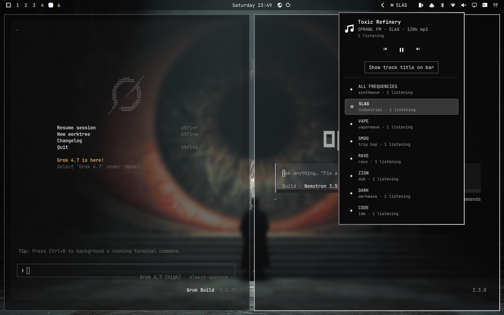
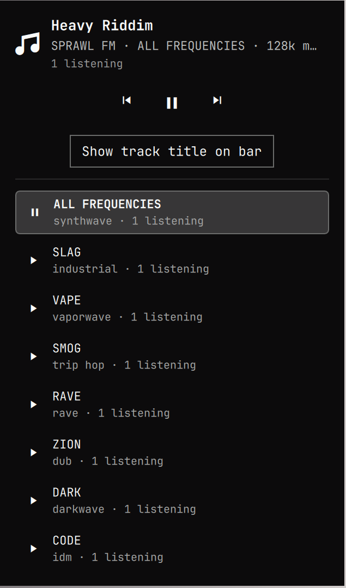

# SPRAWL FM for Omarchy

An Omarchy shell widget for listening to [SPRAWL FM](https://sprawlfm.com/). Tune between eight radio channels, control playback from the bar, and see the current track and listener counts in a popup.



The widget in the bar, with its popup open.



## Features

- Play and pause the stream with `mpv`; switch channels without opening a browser.
- The bar alternates between **SPRAWL** and the channel name, holding each for nine seconds with a one-second slide. All Frequencies is abbreviated to **ALL FREQ**.
- Choose **Show track title on bar** in the popup to show the current track instead; select the button again to return to the alternating display. Long titles are shortened to fit.
- View track information, channel genres, and listener counts in the popup. Set a default channel or remember the last tuned channel.

## Requirements

- Omarchy with the Quickshell-based Omarchy shell and plugin support.
- `mpv` for playback and `curl` for station metadata.
- Internet access to `https://sprawlfm.com`.

## Installation

```sh
omarchy plugin add https://github.com/ben-chitin/sprawl-fm-omarchy.git --enable
```

## Controls

- Click the play/pause icon in the bar to start or stop playback.
- Click the bar label (or right-click the widget) to open the channel popup.
- Scroll over the widget to change channels. In the popup, click a channel to tune and play it; right-click a channel to set or clear it as the default.
- In the popup, Up/Down (or j/k) highlight a channel, Enter or Space tunes in to it (or plays/pauses before anything is highlighted), d sets or clears the highlighted channel as the default, and Esc closes the popup.
- Use the popup's track-title button to switch what the bar displays. The preference persists in the Omarchy bar configuration.
- Middle-click the widget to open SPRAWL FM in a browser.

## Network and privacy

The service requests `https://sprawlfm.com/status-json.xsl` every 15 seconds by default, including while playback is stopped, to display current metadata. The interval can be adjusted with the widget's `refreshIntervalSec` setting (minimum five seconds). Playing a channel connects `mpv` to its SPRAWL FM stream. The last selected channel is stored locally under `${XDG_STATE_HOME:-~/.local/state}/omarchy/sprawlfm/`.

## Origins

Based on the SPRAWL FM widget in [ben-chitin/ben-omarchy](https://github.com/ben-chitin/ben-omarchy), with local bar-display customizations and a track-title toggle.
